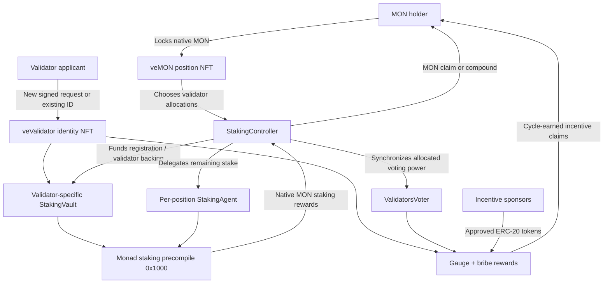

<div align="center">

# Quevra

### Stake together. Back independent validators. Keep your options open.

**A validator-capital and incentive coordination layer for Monad.**

Quevra lets MON holders pool the capital needed to support validators, decide where their stake goes, earn staking rewards and additional incentives, and move that support as their preferences change — **without starting over with a new lock**.

[Explore the contracts](./src) · [How it works](#how-it-works) · [Run the tests](#run-it-yourself) · [What's implemented](#what-is-built-today)

</div>

---

## The problem: who gets to become a validator?

Monad can execute transactions at high speed. But a healthy network also needs a broad, competitive group of validators.

Starting a validator takes more than technical expertise: it takes capital. Monad currently requires **100,000 MON in validator-auth-address stake to register/qualify on that dimension**, while active-set eligibility also depends on **at least 10 million MON in total stake** and a place among the **top 200 validators by stake**. Meeting one threshold does not guarantee a validator will join the active set. [Monad staking documentation](https://docs.monad.xyz/monad-arch/consensus/staking)

That creates a coordination problem:

- **Potential validators** need supporters before they can compete.
- **MON holders** want staking returns but may not have the capital or conviction to back one operator indefinitely.
- **Validators and protocols** need a transparent way to compete for delegated capital beyond reputation alone.

**Quevra turns those separate decisions into one on-chain marketplace for validator support.** Capital follows holders' allocations; incentives give validators a way to attract it.

> **The big idea:** A validator shouldn't have to bring every MON itself. And a holder shouldn't have to unlock and rebuild a position every time they want to support someone else.

## One example, without the jargon

Imagine a new validator operator who has the infrastructure and consensus keys, but not enough MON to register. Three supporters direct **40,000 + 35,000 + 25,000 MON** toward that operator's Quevra vault.

When the vault reaches the configured **100,000 MON registration amount**, Quevra can submit the signed validator-registration request to Monad's native staking system.

Those supporters retain individual, on-chain records of their locked positions. Their allocations also determine their validator voting weight. Later, one supporter can choose a different validator in a subsequent Quevra cycle; the protocol manages the required undelegation, waiting period, withdrawal and redelegation.

If a validator or sponsor offers an approved ERC-20 incentive, supporters who allocated voting weight to that validator during the rewarded cycle can become eligible to claim a share in the following cycle.

**Important:** Registration is not the same as active-set admission. A registered validator still needs to satisfy Monad's broader active-set rules before it can earn consensus rewards.

## How it works



The design connects **three things that are usually separate**:

1. **Capital:** Real MON is locked and accounted for per veMON position.
2. **Choice:** Allocations to validator vaults determine corresponding validator-gauge voting weight. There is no separate user vote transaction to keep in sync with staking.
3. **Rewards:** Native MON rewards from staking and externally funded ERC-20 incentives use distinct accounting and claim paths.

### A holder's journey

| Step | What happens |
| --- | --- |
| **1. Lock MON** | Deposit native MON into a time-bound or permanent `veMON` NFT position. Finite-lock voting power decays over Monad epochs. |
| **2. Back validators** | Allocate that position's MON among validator vaults. The controller deploys through the vault first where registration backing is needed, and uses a position-specific staking agent for additional delegation. |
| **3. Vote by staking** | `ValidatorsVoter` receives allocation updates from the controller and attributes a proportional share of the veMON position's voting power to each validator gauge. Capital staged in a pre-registration vault can also carry allocation weight. |
| **4. Earn** | Staking rewards accrue in native MON where the underlying validator generates rewards. Sponsored, whitelisted ERC-20 incentives are tracked by validator gauge and Quevra cycle. |
| **5. Claim or compound** | Claim native rewards to the wallet, or compound them into the same veMON position's tracked principal and staking allocation. Claim eligible ERC-20 incentives separately. |
| **6. Change your mind** | In a later cycle, replace your target allocations. Anyone can call `poke` to continue withdrawals and redelegations once Monad permits settlement. |
| **7. Exit** | For a finite lock: wait for lock expiry, remove staking allocations, settle pending native withdrawals, and redeem the underlying MON. Claim accrued ERC-20 incentives **before** burning the NFT. |

### A validator's journey

A validator applicant creates a **non-transferable `veValidator` identity**, linked to a dedicated staking vault, a gauge, and a bribe-reward contract.

- **New validator:** Supply a Monad `addValidator` payload with the required secp256k1/BLS signatures, using the deterministic vault address as the auth address. The vault accumulates the registration amount and then calls the staking precompile.
- **Existing validator:** Reference a validator ID known to the staking precompile. Quevra creates the linked vault and gauge for that identity.
- **Compete for backing:** Supporters direct MON to the vault; approved reward tokens can be funded into the associated incentive contract to reward eligible voting weight.

An existing validator ID is checked for existence, but the current onboarding path does **not** fully prove that the identity creator controls the validator's native auth address. That authorization is a hardening item before unrestricted deployment.

## The mechanism that makes Quevra different

**Your allocation is your vote.**

Traditional vote-escrow designs often let users vote with abstract governance power while the underlying stake lives somewhere else. Quevra binds the two together: the controller synchronizes validator-gauge weights as it moves a position's MON allocation.

The per-gauge weight is calculated from the position's voting power and its share of MON allocated to that validator:

```text
validator gauge weight ≈ veMON voting power × allocated MON / position principal
```

Unallocated principal does not create validator-gauge weight. Changes to physical allocations update the associated vote/reward accounting. This gives operators a direct reason to earn real backing, while holders can allocate across more than one validator.

**Rebalancing is asynchronous by design.** Monad changes are epoch-bound and undelegations have a native withdrawal delay. Quevra records the user's *desired* allocations, carries out available actions, and exposes permissionless `poke(tokenId)` calls to complete outstanding transitions after settlement becomes possible. A reallocation request is **not** a promise of instant redelegation.

**Incentives have a clear clock.** Quevra groups Monad epochs into economic *cycles* (currently **five epochs per cycle** in `ProtocolTimeLibrary`, a testnet-oriented parameter). Incentives funded in cycle `c` are accounted against that cycle's recorded vote weights and become claimable beginning in **cycle `c+1`**, not immediately. Reward funding actually transfers ERC-20 tokens into the rewards contract; a notification alone does not mint rewards.

## What is built today

This repository contains a **Solidity / Foundry contracts prototype**, not a deployed consumer app or an audited mainnet product.

| Component | Implementation | Why it matters |
| --- | --- | --- |
| Locked MON positions | [`VeMON.sol`](./src/VeMON.sol), [`VotingEscrow.sol`](./src/VotingEscrow.sol) | Native MON custody, ERC-721 positions, finite/permanent locks, epoch-based voting power and checkpoints. |
| Validator identities | [`VeValidator.sol`](./src/VeValidator.sol) | Non-transferable validator records; new signed-payload submissions or existing validator IDs; linked vault/gauge identities. |
| Capital routing | [`StakingController.sol`](./src/staking/StakingController.sol), [`StakingAdmin.sol`](./src/staking/StakingAdmin.sol) | Position balances, desired allocations, delayed settlement, validator onboarding, reward claims and compounding. |
| Native staking custody | [`StakingVault.sol`](./src/staking/controlled/StakingVault.sol), [`StakingAgent.sol`](./src/staking/controlled/StakingAgent.sol) | Validator-specific capital pools and position-specific delegations using Monad's actual `0x1000` staking interface. |
| Stake-linked voting | [`ValidatorsVoter.sol`](./src/voting/ValidatorsVoter.sol) | Synchronizes vote weights with allocations and links validators to gauges and bribe-reward contracts. |
| Incentives | [`BribeVotingRewards.sol`](./src/rewards/BribeVotingRewards.sol), [`Reward.sol`](./src/rewards/Reward.sol), [`NonStakingGauge.sol`](./src/gauges/NonStakingGauge.sol) | Cycle-scoped ERC-20 bribe funding/claims and a separate validator-beneficiary gauge reward channel. |
| Protocol clock | [`ProtocolTimeLibrary.sol`](./src/libraries/ProtocolTimeLibrary.sol) | Uses Monad staking epochs, effective-epoch rules and cycle boundaries instead of wall-clock guesses. |

The code also implements validator voting-power boosts, bounded to **5×**, through the validator escrow/voter machinery. This is **not** a claim of 5× MON principal or staking yield.

### Why native Monad integration matters

Quevra is not merely a token-weighted poll. Its vaults and agents make native staking calls for `addValidator`, `delegate`, `undelegate`, `withdraw`, and reward operations through Monad's **staking precompile at `0x1000`**. The system has to respect Monad's staking epoch transitions, delayed withdrawals and validator-state constraints. [Monad staking API](https://docs.monad.xyz/reference/staking/api)

### Monad testnet deployment

The judging requirements call for a working Monad deployment and contract addresses. The current deployment artifacts record this Quevra deployment on **Monad testnet (chain ID `10143`)**, created on **October 12, 2026 UTC**, with implementations upgraded and Sourcify-verified the same day against commit `dd2ecb2`. The core modules are UUPS proxies; vaults, agents, gauges, and bribe rewards are created through shared beacons.

| Contract | Deployment address | Type |
| --- | --- | --- |
| `StakingController` | `0x8e119Bfe93dB45Cb456B3ACE1a3935958E8dC04f` ([artifact](./deployments/monadTestnet/StakingController.json)) | UUPS proxy |
| `ValidatorsVoter` | `0x46Eb9dfa056A40C3AC2C65914aA792790227A3aF` ([artifact](./deployments/monadTestnet/ValidatorsVoter.json)) | UUPS proxy |
| `VeMON` | `0xd699f3CF29614Cb9f44ab3e43e32cC271635D838` ([artifact](./deployments/monadTestnet/VeMON.json)) | UUPS proxy |
| `VeValidator` | `0xbD243E21D28050F805Af0052a6E512C001152C5B` ([artifact](./deployments/monadTestnet/VeValidator.json)) | UUPS proxy |
| `StakingVault` beacon | `0x2E9eAa58834c39a8bDe92886Cbf8A18954bFF855` ([artifact](./deployments/monadTestnet/StakingVaultBeacon.json)) | Shared beacon |
| `StakingAgent` beacon | `0x862f45A57f83393AC5a01c5860DF2A5e051501C4` ([artifact](./deployments/monadTestnet/StakingAgentBeacon.json)) | Shared beacon |
| `NonStakingGauge` beacon | `0x42A667DA858117d3ac3109046f2A8aC00876e62F` ([artifact](./deployments/monadTestnet/NonStakingGaugeBeacon.json)) | Shared beacon |
| `BribeVotingRewards` beacon | `0xe433b856a1c88ec70AAC8D98bcc2a5db8dFa340F` ([artifact](./deployments/monadTestnet/BribeVotingRewardsBeacon.json)) | Shared beacon |

Live implementations behind those proxies/beacons are verified on Monad BlockVision Sourcify:

| Implementation | Address | Sourcify |
| --- | --- | --- |
| `StakingController` | `0x52fCd2B289Bf6020814C01441cE17F193DCf4f68` | [verified](https://sourcify-api-monad.blockvision.org/repo-ui/10143/0x52fCd2B289Bf6020814C01441cE17F193DCf4f68) |
| `VeMON` | `0x6AfACEd35fe320c8073eedf29ec45578e48f03F4` | [verified](https://sourcify-api-monad.blockvision.org/repo-ui/10143/0x6AfACEd35fe320c8073eedf29ec45578e48f03F4) |
| `ValidatorsVoter` | `0x771E9F62cCb57e0e5a1ab5AFCcf72096A61A1c65` | [verified](https://sourcify-api-monad.blockvision.org/repo-ui/10143/0x771E9F62cCb57e0e5a1ab5AFCcf72096A61A1c65) |
| `VeValidator` | `0xbA22f457DE1D85D02a2e350E18EFD9eBA52e4Ef8` | [verified](https://sourcify-api-monad.blockvision.org/repo-ui/10143/0xbA22f457DE1D85D02a2e350E18EFD9eBA52e4Ef8) |
| `StakingVault` | `0xeB91BF4aB460071C9F2677cCD17572Ff50082bc1` | [verified](https://sourcify-api-monad.blockvision.org/repo-ui/10143/0xeB91BF4aB460071C9F2677cCD17572Ff50082bc1) |
| `StakingAgent` | `0x87378C2720cd08cE209a3557bB1d19286fd98652` | [verified](https://sourcify-api-monad.blockvision.org/repo-ui/10143/0x87378C2720cd08cE209a3557bB1d19286fd98652) |
| `NonStakingGauge` | `0x4D11e14fd1a803e1455703b28b425a547C156362` | [verified](https://sourcify-api-monad.blockvision.org/repo-ui/10143/0x4D11e14fd1a803e1455703b28b425a547C156362) |
| `BribeVotingRewards` | `0xE075a3e3538687Eb08b798e6D43591483Af03725` | [verified](https://sourcify-api-monad.blockvision.org/repo-ui/10143/0xE075a3e3538687Eb08b798e6D43591483Af03725) |

Proxy and beacon addresses are also browsable on [MonadVision testnet](https://testnet.monadvision.com) and [Monadscan testnet](https://testnet.monadscan.com). The configured ERC-20 incentive reward token is `0xFb8bf4c1CC7a94c73D209a149eA2AbEa852BC541`; it is recorded as deployment configuration, not as a Quevra-deployed contract. Individual validator vaults, staking agents, gauges, and bribe-reward instances are created through their beacons, so their addresses depend on validator onboarding and gauge creation. Re-check live state with `pnpm --filter @quevra/contracts deploy:status --network monadTestnet` and re-submit sources with `pnpm --filter @quevra/contracts deploy:verify --network monadTestnet` after any upgrade.

## Run it yourself

**Requirements:** Git (with submodules) and [Foundry](https://book.getfoundry.sh/) (`forge`). A compatible Monad RPC is needed for fork-dependent tests. Node/pnpm are optional convenience tooling for the package scripts.

```bash
git clone --recurse-submodules --branch mezo-earn-alignment https://github.com/newtmex/quevra-contracts.git
cd quevra-contracts

forge build
forge fmt --check
forge test --network monad -vvv
```

The Foundry configuration targets **Monad testnet (chain ID `10143`)** and pins a fork block for reproducibility. Override the RPC using your own endpoint if the public testnet RPC is unavailable.

### What to inspect first (for judges and contributors)

| Question | Evidence in this repository |
| --- | --- |
| Can several positions help register a validator? | [`test/VeValidator.t.sol`](./test/VeValidator.t.sol) and [`test/StakingVault.t.sol`](./test/StakingVault.t.sol) |
| Can one locked MON position move support between validators? | [`test/integration/StakingControllerRebalance.t.sol`](./test/integration/StakingControllerRebalance.t.sol) — `test_reusesLockedMONWhenReallocatingAcrossValidators` |
| Does stake allocation update vote and bribe-accounting weight? | [`test/VeValidator.t.sol`](./test/VeValidator.t.sol) — `test_bribeWeightFollowsControllerStakeAndUndelegation`, `test_rebalancePokeMovesVoteWeightWithPhysicalStake` |
| Is there a complete ERC-20 bribe fund → `c+1` claim path? | [`test/integration/BribeIncentiveFlow.t.sol`](./test/integration/BribeIncentiveFlow.t.sol) — proportional payout, cycle boundary, later vote changes, unauthorized claims, claim-before-exit |
| Are vault reward shares attributed per position? | [`test/integration/StakingControllerRebalance.t.sol`](./test/integration/StakingControllerRebalance.t.sol) — shared-vault/reward tests |
| Is there a native reward claim/compound/exit scenario? | [`test/integration/ForkNativeRewards.t.sol`](./test/integration/ForkNativeRewards.t.sol) — `test_forkConsensusRewardsCanBeCompoundedClaimedAndWithdrawn` |

Try an individual test with:

```bash
forge test --network monad --match-test test_reusesLockedMONWhenReallocatingAcrossValidators -vvv
forge test --network monad --match-test test_bribeWeightFollowsControllerStakeAndUndelegation -vvv
forge test --network monad --match-contract BribeIncentiveFlowIntegrationTest -vvv
```

These paths are **source-level evidence**, not a claim that every test has passed in your environment. Fork-dependent cases need the configured network's staking state. The bribe integration suite covers stake-linked gauge weight, real ERC-20 funding in cycle `c`, and claimable payouts beginning in cycle `c+1`.

## Honest project status

**Implemented in the branch:** native MON lock positions; new/existing validator identity creation; vault/agent staking routes; stake-linked validator voting; native rewards claim/compound paths; cycle-based bribe contracts with integration coverage for fund → `c+1` claim, later vote changes, authorization, and claim-before-exit; and unit/integration test scenarios.

**Still needed before a production or public hackathon deployment:**

- Repeatable public demo transactions on the verified testnet deployment.
- Repair and rerun the Solonet E2E runner against the *current* controller/validator identity flow.
- Security review of validator authorization, reward accounting, lock exits, keeper transitions and operational permissions.
- Broader user-facing tooling and an operator onboarding guide beyond the deployment/upgrade docs.

**Not claimed here:** a transferable liquid-staking token, a live DeFi integration, `QUE`/`veQUE` governance, validator active-set admission guarantees, a promised staking APR, or an audited/mainnet-ready release. The veMON NFT represents a **locked** position; its underlying MON is not instantly redeemable.

## Built for Monad, informed by vote-escrow protocols

Quevra uses Monad's native staking mechanics for the *capital* leg and adapts vote-escrow/gauge ideas for the *coordination* leg. The voting and rewards architecture draws from [Mezo Earn / Tigris](https://github.com/mezo-org/tigris), with roots in the wider Solidly/Velodrome/Curve design family. The original idea is the integration of actual MON staking allocations, validator onboarding, position accounting and validator-specific incentive markets into one flow.

### Licensing and attribution

**This repository is not uniformly MIT-licensed.** Quevra-authored files generally use `SPDX-License-Identifier: MIT`, while certain adapted Tigris sources — notably [`VotingEscrow.sol`](./src/VotingEscrow.sol), [`ValidatorsVoter.sol`](./src/voting/ValidatorsVoter.sol), [`NonStakingVoter.sol`](./src/voting/NonStakingVoter.sol), and [`VotingReward.sol`](./src/rewards/VotingReward.sol) — declare **BUSL-1.1**. Preserve each file's SPDX identifier, existing attribution, applicable upstream license terms and notices. Do not replace BUSL headers with MIT merely because the rest of the project prefers MIT. Third-party dependencies retain their respective licenses.

AI-assisted coding tools were used during development and documentation. The protocol's design choices, repository contents and security responsibilities remain with its maintainers.

## Upgradeable deployment infrastructure

The contracts package includes a Hardhat 3 + TypeScript deployment and upgrade workflow alongside Foundry. Four core modules use UUPS proxies; vaults, agents, gauges, and bribe contracts use four family-specific beacons. See [architecture](./docs/architecture.md), [deployment](./docs/deployment.md), and [upgrades](./docs/upgrades.md) for owner authority, command examples, deterministic vault prediction, and operational limitations.

After configuring `.env` with an RPC, deployer key, multisig, delay, and reward token:

```bash
pnpm --filter @quevra/contracts deploy:all --network monadTestnet
pnpm --filter @quevra/contracts deploy:status --network monadTestnet
pnpm --filter @quevra/contracts deploy:verify --network monadTestnet
```

This repository change does not upgrade earlier non-proxy deployments. Protocol-owned state now uses ERC-7201 namespaces; this layout does not automatically migrate sequential-storage state from an already deployed implementation. Foundry fork/Solonet tests remain the source of evidence for Monad's native staking precompile; Hardhat local tests cover proxy, initializer, and upgrade mechanics.

---

<div align="center">

### Quevra's bet

**Better validators need a path to capital. MON holders need a reason — and a way — to back them.**

Quevra is building that path on Monad.

*Built for the Monad Metropolis hackathon. Contributions, review and critical feedback are welcome.*

</div>
